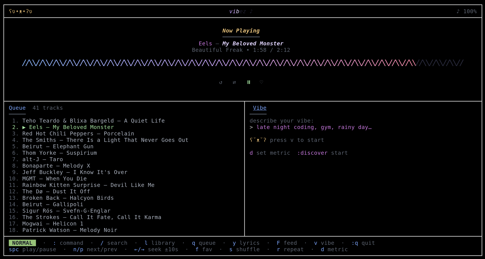
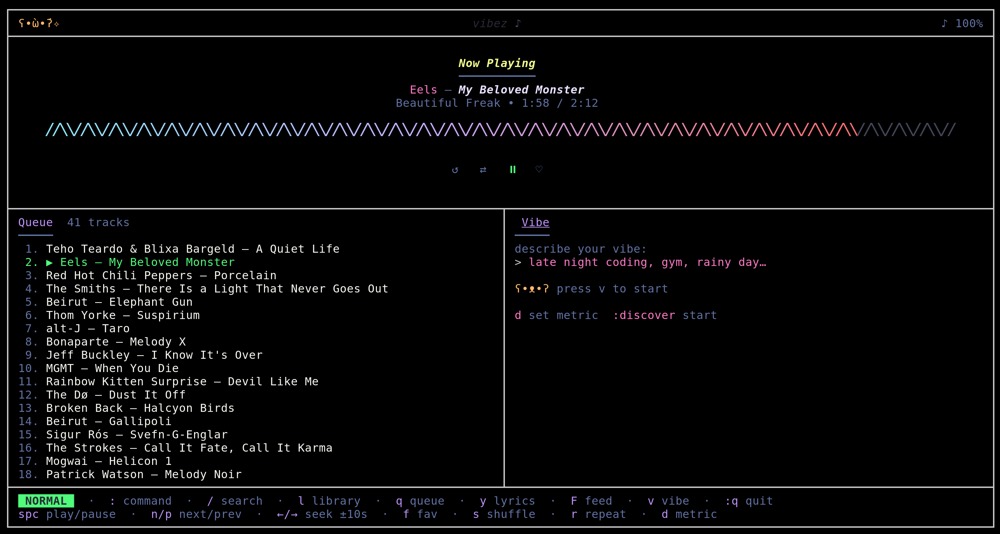
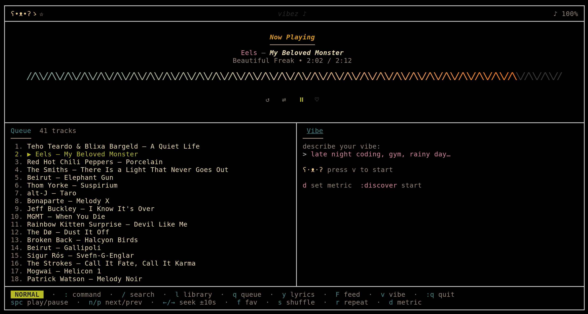
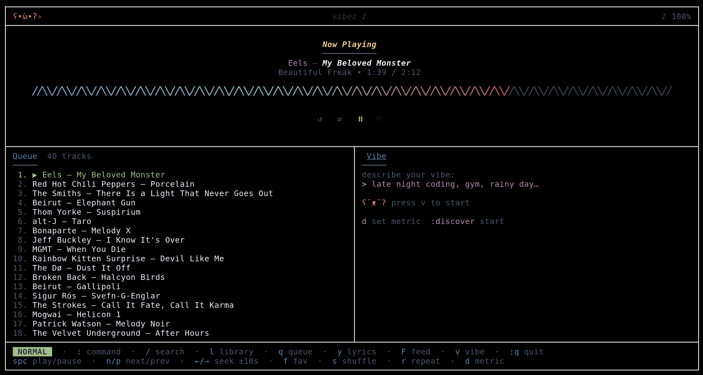

<p align="center">
  
</p>

<p align="center">
  
</p>

<p align="center">
  <strong>Apple Music in your terminal. Vibe-driven. Keyboard-first.</strong>
</p>

<p align="center">
  <a href="https://github.com/simonepelosi/vibez/actions"></a>
  <a href="https://github.com/simonepelosi/vibez/releases"></a>
  <a href="https://github.com/simonepelosi/vibez/blob/main/go.mod"></a>
  <a href="https://github.com/simonepelosi/vibez/blob/main/LICENSE"></a>
  <a href="https://github.com/simonepelosi/vibez/releases"></a>
  <a href="https://github.com/simonepelosi/vibez/stargazers"></a>
  <a href="https://matrix.to/#/#vibez-player:matrix.org"></a>
</p>

<p align="center">
  If you enjoy vibez, consider supporting its development — it helps keep the project alive! ☕<br><br>
  <br><br>
  <a href="https://ko-fi.com/pelpsi"></a><br><br>
  <a href="https://matrix.to/#/#vibez-player:matrix.org"></a>
</p>

[Installation](#installation) · [Usage](#usage) · [Features](#features) · [Key Bindings](#key-bindings) · [Configuration](#configuration) · [Audio Engine](#audio-engine) · [Roadmap](#roadmap) · [Matrix Chat](https://matrix.to/#/#vibez-player:matrix.org)

---

**vibez** is an open-source terminal music player for **Linux**, **macOS**, and **Windows**. Search Apple Music, play local lossless libraries, explore by mood, view synced lyrics, and control everything without leaving your keyboard.

Full Apple Music tracks stream natively with an **in-process Widevine CDM** and platform-native audio output (GStreamer on Linux, Core Audio on macOS, and Media Foundation + `waveOut` on Windows) — no Chrome, Chromium, Playwright, WebKit, or Node.js required. If no existing Widevine CDM library is found on your system, vibez automatically downloads the official standalone component into its cache on first launch.

Prefer playing offline? Launch `vibez --local` to play local audio files directly, `--hybrid` to substitute local lossless files seamlessly inside Apple Music queues, or `--demo` to explore the UI with no account at all.

---

## Features

### 🎵 Native Streaming & Playback

- **In-process Widevine CDM playback** — full-track Apple Music streaming (`256 kbps` or `64 kbps` AAC) plus iCloud-uploaded library track playback (`.mp3` / `.m4a`) with sub-second startup and zero browser processes
- **Audio format & capability telemetry** — Now Playing shows the active stream format alongside catalog capabilities (e.g. `AAC 256 (catalog: Hi-Res, Atmos)`) or the local file format (`FLAC`, `WAV`, `MP3`)
- **Full playback controls** — play/pause, next, previous, seek ±10 s or jump to `:seek <seconds>`, volume adjustment, mute (`:mute`), repeat off/all/one (`r`), and shuffle (`s`)

### 🎛️ 10-Band Parametric Equalizer

- **Full-width equalizer panel (`e`)** — adjust 10 ISO bands (`32 Hz` – `16 kHz`) across ±12 dB in 0.5 dB steps
- **Live & persistent** — changes apply immediately to the active native audio pipeline (GStreamer `equalizer-10bands` on Linux, biquad EQ on macOS and Windows) and persist automatically to config

### 🔍 Search, Library, Feed & Queue

- **Real-time catalog search (`/`)** — search songs, albums, artists, and playlists as you type; vibez preserves your query, scroll offset, and selection across reopening Search
- **Library browser (`l` / `L`)** — browse saved playlists, albums, artists, and songs; press `L` anytime to jump straight back to the top level
- **Recommendation feed (`F`)** — explore Apple Music editorial and personalised shelves directly from the TUI
- **Queue drawer (`q`)** — append (`tab` / `a`), insert next (`shift+tab`), reorder, remove, clear, start track-seeded radio (`R`), add to playlists (`p`), or `:save <name>` as an Apple Music playlist

### 📝 Synced Lyrics (`y`)

- **LRCLIB integration** — automatically fetches synced (including enhanced word-timed LRC) or plain lyrics for the playing track
- **Live highlighting & lyric seeking** — follows playback in real time, and lets you scroll with `j`/`k` and press `enter` to seek directly to any synced lyric line

### 🌀 Vibe Mode (`v`), Discovery (`d`), and Radio (`R`)

- **Vibe Mode (`v`)** — describe a mood or activity in plain language (`"late night coding"`, `"Sunday morning chill"`). Automatically uses an available on-device LLM runtime (**Ollama**, **LM Studio**, **`llama.cpp` / `llama-server`**, or any OpenAI-compatible `vibe_endpoint`) and transparently falls back to the built-in zero-dependency keyword mood planner
- **Discovery Mode (`d` / `:discover <n>|auto`)** — open a 5-step similarity picker (`same artist` to `pure discovery`), dial similarity live with `+`/`-`, and auto-queue related tracks continuously or in batches
- **Radio Mode (`R` / `ctrl+r`)** — seed an endless Apple Music station from the playing track, a queued track, or a search result

### 📂 Local & Hybrid Playback (`--local` / `--hybrid`)

- **Standalone offline player (`--local`)** — scan `--music-dir` recursively and play local audio libraries without an Apple Music account
- **Hybrid lossless substitution (`--hybrid`)** — keep your Apple Music queues, playlists, Discovery, and Vibe Mode, while automatically playing matching local lossless files (`.flac`, ALAC `.m4a`, `.wav`, `.aiff` via ISRC or strict metadata match) whenever present on disk

### 🖼️ Terminal UI, Cover Art & Themes

- **Album-art view (`:art`)** — renders track artwork as dithered Unicode sextants (or half-blocks on Terminal.app) in 256+ color terminals
- **Vim-first UX** — `j`/`k`/`gg`/`G` navigation, `:` command palette with Tab completion, `:debug-logs` viewer, and an animated bear mascot that dances while music plays
- **Built-in & custom themes** — ships with `default`, `dracula`, `gruvbox`, and `nord`, plus hot-customisable JSON palettes

### 🖥️ System Integration & Scrobbling

- **Linux MPRIS D-Bus** — media keys, desktop player widgets, and automatic desktop entry/icon installation
- **Windows SMTC** — native System Media Transport Controls for hardware media keys, volume flyout, and desktop widgets such as YASB
- **Discord Rich Presence** — displays the playing track, artist, album, cover art, and timestamps (disable with `--no-discord` or `"discord_rpc": false`)
- **Last.fm scrobbling** — connect once with `vibez auth lastfm login`
- **Built-in updater** — checks GitHub Releases on startup with checksum verification and seamless restart (skip with `--no-update`)

---

## Installation

### Linux & macOS (one-liner)

```sh
curl --proto '=https' --tlsv1.2 -sSf \
  https://raw.githubusercontent.com/simonepelosi/vibez/main/scripts/install.sh | sh
```

Installs the latest release binary (`linux/amd64`, `darwin/arm64`, `darwin/amd64`) to `~/.local/bin/` and updates your shell profile if needed. Linux/arm64 binaries are not published yet — build [from source](#from-source) instead.

> **Update:** re-running the installer (or launching vibez with auto-update enabled) updates to the latest release.
>
> **Custom directory:** `VIBEZ_INSTALL_DIR=/usr/local/bin curl ... | sh`

> **Linux runtime dependencies:** GStreamer needs `playbin`, `equalizer-10bands`, and an AAC decoder (`avdec_aac`, `faad`, or `fdkaacdec`):
>
> - **Debian / Ubuntu:** `sudo apt install gstreamer1.0-plugins-base gstreamer1.0-plugins-good gstreamer1.0-libav`
> - **Arch:** `sudo pacman -S gst-plugins-base gst-plugins-good gst-libav`
> - **Fedora:** `sudo dnf install gstreamer1-plugins-base gstreamer1-plugins-good gstreamer1-libav`
>
> Optional for 24/32-bit local AIFF files: install `gstreamer1.0-plugins-bad` (Debian/Ubuntu) or `gst-plugins-bad` (Arch/Fedora) for `aiffparse`.

### Windows (x64)

Download `vibez_windows_amd64.zip` from the [latest release](https://github.com/simonepelosi/vibez/releases) and extract `vibez.exe` into a writable folder, or build from source with Go 1.26+ and MinGW-w64 (`CGO_ENABLED=1`):

```powershell
$env:CGO_ENABLED = "1"
go build -o vibez.exe .
.\vibez.exe --demo
.\vibez.exe --local --music-dir "$env:USERPROFILE\Music"
```

Apple Music streaming and `--local` playback run natively via Media Foundation and `waveOut` with a 10-band biquad equalizer. Configuration lives at `%APPDATA%\vibez\config.json` and the Widevine cache at `%LOCALAPPDATA%\vibez\cdm`.

### From source

Prebuilt release binaries fetch short-lived Apple developer tokens automatically from the [token broker](worker/README.md), so end users do **not** need an Apple Developer account. When building from source yourself:

```bash
git clone https://github.com/simonepelosi/vibez
cd vibez
make build
```

You can test immediately without Apple credentials using `--demo` or `--local`:

```bash
./vibez --demo
./vibez --local --music-dir ~/Music
```

To stream Apple Music from a source build, supply your own MusicKit developer token:

```bash
# Option A: embed a developer token into the binary (valid up to 30 days)
make build-with-token   # reads APPLE_KEY_ID, APPLE_TEAM_ID, APPLE_PRIVATE_KEY from env or .env
make install            # builds with token and installs to ~/.local/bin (override with PREFIX=...)

# Option B: build normally and write a fresh developer token into config.json
make refresh-token
```

**Build requirements:** Go 1.26+ · on Linux: GStreamer development headers (`libgstreamer1.0-dev libgstreamer-plugins-base1.0-dev` on Debian/Ubuntu) + runtime plugins above · on macOS: Xcode Command Line Tools (`xcode-select --install`) · on Windows: MinGW-w64 (`x86_64-w64-mingw32-gcc` / `g++`, `CGO_ENABLED=1`) · see [CONTRIBUTING.md](CONTRIBUTING.md) for full contributor setup details.

---

## Usage

```bash
vibez                                      # launch Apple Music TUI (authenticates if needed)
vibez --demo                               # run with built-in demo tracks — no account needed
vibez --local --music-dir ~/Music          # play local audio files offline — no account needed
vibez --hybrid --music-dir ~/Music         # stream Apple Music, preferring matching local lossless files
vibez auth login                           # authorise Apple ID in your browser
vibez auth status                          # show Apple Music authentication & storefront state
vibez auth logout                          # clear saved Apple Music user token
vibez auth lastfm login                    # connect Last.fm scrobbling (optional)
vibez auth lastfm status                   # check Last.fm scrobbling status
vibez auth lastfm logout                   # disconnect Last.fm
vibez version                              # print version info
```

### CLI Flags

| Flag | Description |
|------|-------------|
| `--demo` | Run with built-in demo catalog and player (no Apple ID or internet required) |
| `--local` | Run offline against local audio files from `music_dir` / `--music-dir` |
| `--hybrid` | Substitute matching local lossless files from `music_dir` inside Apple Music queues |
| `--music-dir <path>` | Path to local music directory (persisted to `config.json`) |
| `--config <path>` | Custom config file path (defaults to `~/.config/vibez/config.json` or `%APPDATA%\vibez\config.json`) |
| `--no-discord` | Disable Discord Rich Presence for this session |
| `--no-update` | Skip automatic startup update check |
| `--mem-profiling` | Display live process RSS memory usage in the TUI header |
| `--debug` | Enable debug logging to stderr |

---

## Theming

<table>
  <tr>
    <td align="center">
      <br>
      <sub><b>default</b> (Tokyo Night / Catppuccin)</sub>
    </td>
    <td align="center">
      <br>
      <sub><b>dracula</b></sub>
    </td>
  </tr>
  <tr>
    <td align="center">
      <br>
      <sub><b>gruvbox</b></sub>
    </td>
    <td align="center">
      <br>
      <sub><b>nord</b></sub>
    </td>
  </tr>
</table>

Set `"theme"` in `~/.config/vibez/config.json` (`%APPDATA%\vibez\config.json` on Windows):

```json
{
  "theme": "dracula"
}
```

**Built-in themes:** `default`, `dracula`, `gruvbox`, `nord`

### Custom themes

Create `~/.config/vibez/themes/<name>.json` (`%APPDATA%\vibez\themes\<name>.json` on Windows) with any subset of hex `#rrggbb` / `#rgb` fields — omitted or invalid values fall back to `default`:

```json
{
  "primary":      "#ff79c6",
  "secondary":    "#50fa7b",
  "muted":        "#6272a4",
  "error":        "#ff5555",
  "fg":           "#f8f8f2",
  "subtle":       "#8be9fd",
  "bg":           "#282a36",
  "love":         "#ff6e6e",
  "active":       "#50fa7b",
  "progress":     "#8be9fd",
  "surface":      "#44475a",
  "accent":       "#bd93f9",
  "accent_warm":  "#f1fa8c",
  "bear":         "#ffb86c",
  "glow_palette": ["#282a36","#383a52","#44475a","#6272a4","#9580ff","#bd93f9","#caa9fa","#e9e0ff"],
  "mode_normal_bg":  "#50fa7b",
  "mode_search_bg":  "#8be9fd",
  "mode_command_bg": "#f1fa8c",
  "mode_chip_fg":    "#282a36"
}
```

Set `"theme": "<name>"` in `config.json` and restart vibez.

---

## Key Bindings

### Global

| Key | Action |
|-----|--------|
| `space` | Play / Pause |
| `n` | Next track |
| `p` | Previous track |
| `←` / `→` | Seek backward / forward 10 s (when no sub-panel captures left/right) |
| `+` / `=` | Volume up (+5%) — or increase similarity when Discovery Mode is active |
| `-` | Volume down (-5%) — or decrease similarity when Discovery Mode is active |
| `r` | Cycle repeat mode (`off → all → one`) |
| `s` | Toggle shuffle |
| `f` | Love / favourite current track |
| `x` | Suggest Less — dislike/skip track (press again before skip clears) |
| `/` | Open catalog/library search |
| `:` | Open command prompt |
| `l` | Toggle Library panel |
| `L` | Reset Library panel to top level and open it |
| `q` | Toggle Queue panel |
| `y` | Toggle Lyrics panel |
| `F` | Toggle Recommendation Feed panel |
| `e` | Toggle Equalizer panel |
| `v` | Focus Vibe Mode input |
| `d` | Open Discovery similarity picker / toggle Discovery Mode off |
| `R` | Toggle Radio Mode seeded by the currently playing track |
| `?` | Toggle About & support panel |
| `:q` / `ctrl+c` | Quit |

### Search (`/`)

Search retains your last query, result list, scroll offset, and open artist view across close/reopen.

| Key | Action |
|-----|--------|
| *(type)* | Search tracks, albums, artists, and playlists (400 ms debounce) |
| `↑` / `↓` | Navigate results |
| `ctrl+↑` / `ctrl+↓` (or `shift+↑` / `shift+↓`) | Jump to previous / next result section |
| `enter` | Play selected item now |
| `tab` | Add selected item to queue |
| `shift+tab` | Play next (insert immediately after current track) |
| `ctrl+r` | Start radio station seeded by selected track |
| `ctrl+a` / `home`, `ctrl+e` / `end` | Move cursor to start / end of query |
| `ctrl+w` / `ctrl+u` | Delete previous word / clear query before cursor |
| `esc` | Close search (preserves results) |

### Library (`l` / `L`)

| Key | Action |
|-----|--------|
| `↑` / `↓` (or list navigation) | Browse sections, playlists, albums, artists, or tracks |
| `enter` | Open selected container or play track |
| `tab` | Queue selected item/track (or advance section tabs) |
| `shift+tab` | Play next |
| `esc` / `backspace` / `b` | Go back a level / close panel |

### Queue (`q`)

| Key | Action |
|-----|--------|
| `↑` / `k`, `↓` / `j` | Navigate queue |
| `enter` | Play from selected position |
| `d` | Remove selected track from queue |
| `K` / `shift+up` / `ctrl+up` | Move track up |
| `J` / `shift+down` / `ctrl+down` | Move track down |
| `c` | Clear entire queue |
| `s` | Open `:save ` prompt to save queue as an Apple Music playlist |
| `p` | Add highlighted track to an Apple Music playlist |
| `R` | Toggle Radio Mode seeded by the highlighted queue track |
| `esc` / `q` | Close queue panel |

### Lyrics (`y`)

| Key | Action |
|-----|--------|
| `↑` / `k`, `↓` / `j` | Scroll lyrics / move lyric cursor |
| `gg` / `G` | Jump to top / bottom |
| `enter` | Seek directly to the highlighted lyric line (synced LRC tracks) |
| `esc` / `y` | Close lyrics panel |

### Equalizer (`e`)

| Key | Action |
|-----|--------|
| `←` / `h`, `→` / `l` | Select frequency band |
| `↑` / `k`, `↓` / `j` | Adjust band gain (±0.5 dB, range `-12` to `+12 dB`) |
| `0` | Reset current band to 0 dB |
| `r` | Reset all bands to flat |
| `esc` / `e` | Close equalizer panel |

### Discovery (`d`) & About (`?`)

- **Discovery picker:** `↑`/`↓` or `j`/`k` choose similarity preset (`0.95` same artist → `0.10` pure discovery), `enter` confirms, `+`/`-` adjust on the fly, `d` stops discovery.
- **About (`?`):** `enter` or `d` opens the Ko-fi support page in your browser.

### Command mode (`:`)

Press `:` anywhere to open the command bar. Use `↑`/`↓` (`ctrl+p`/`ctrl+n`) and `tab` for autocomplete:

| Command | Description |
|---------|-------------|
| `:save <name>` (or `:save-playlist <name>`) | Save the current queue as an Apple Music playlist |
| `:discover <n>\|auto` | Queue *n* discovered songs once, or auto-discover continuously |
| `:vol <0-100>` | Set playback volume (e.g. `:vol 80`) |
| `:vol +n` / `:vol -n` | Adjust volume by ±*n*% (or `:vol` to display current level) |
| `:mute` | Toggle mute and restore previous level |
| `:seek <seconds>` | Seek to an absolute timestamp (or `:seek` to print current timestamp) |
| `:quality <high\|standard\|256\|64>` | Switch Apple Music AAC bitrate (`256` or `64` kbps) |
| `:art` | Toggle cover-art mode in the Now Playing panel (saved to config) |
| `:debug-logs` | Toggle the debug log panel |
| `:about` | Open the About & support panel |
| `:donate` | Open Ko-fi donation page in browser |
| `:q` / `:quit` | Quit vibez |

---

## Configuration

Configuration is stored as JSON at `~/.config/vibez/config.json` on Linux/macOS and `%APPDATA%\vibez\config.json` on Windows (created automatically on first run, or overridden with `--config <path>`):

```json
{
  "theme": "default",
  "audio_quality": "high",
  "album_art": false,
  "music_dir": "/path/to/your/Music",
  "hybrid_playback": false,
  "discord_rpc": true,
  "vibe_backend": "auto",
  "vibe_model": "",
  "vibe_endpoint": "",
  "vibe_timeout": "30s"
}
```

### Selected options

| Key | Description | Default |
|-----|-------------|---------|
| `theme` | Palette name (`default`, `dracula`, `gruvbox`, `nord`, or `<name>` in `themes/`) | `"default"` |
| `audio_quality` | Apple Music AAC tier: `"high"` (`"256"`) or `"standard"` (`"64"`) | `"high"` |
| `album_art` | Start Now Playing in album-art mode (toggled by `:art`) | `false` |
| `music_dir` | Root directory scanned recursively by `--local` and `--hybrid` | `""` |
| `hybrid_playback` | Prefer matching local lossless files inside Apple Music queues | `false` |
| `discord_rpc` | Enable Discord Rich Presence (`--no-discord` overrides at runtime) | `true` |
| `discord_client_id` | Custom Discord application ID override | `""` |
| `vibe_backend` | Vibe planner: `"auto"`, `"ollama"`, `"lmstudio"`, `"llamacpp"`, `"openai"` (OpenAI-compat local URL), `"keyword"` | `"auto"` |
| `vibe_model` | Optional model name override for the Vibe LLM planner | auto-detected |
| `vibe_endpoint` | Custom URL for Ollama / LM Studio / `llama-server` / OpenAI-compatible runtime | local defaults |
| `vibe_timeout` | Timeout for LLM Vibe planning (e.g. `"30s"`, `"1m"`) | `"30s"` |
| `auth_port` | Localhost callback port during `vibez auth login` | `7777` |
| `storefront` | Override Apple Music storefront code (auto-detected on login) | `""` |
| `wsl` | Audio buffer tuning hint for WSL2 environments | `false` |
| `lastfm_api_key` / `_secret` / `_session_key` | Last.fm credentials (release builds embed API key/secret automatically) | `""` |

**Environment variables:** set `VIBEZ_CDM_PATH` to point to a specific Widevine CDM library (`libwidevinecdm.so`, `libwidevinecdm.dylib`, or `widevinecdm.dll`) instead of auto-discovering or downloading.

---

## Audio Engine

| Platform | Apple Music Streaming | Local Files (`--local`) |
|----------|-----------------------|-------------------------|
| **Linux** | In-process Widevine CDM + GStreamer (`playbin` + `equalizer-10bands`) | `.mp3`, `.flac`, `.m4a`, `.ogg`, `.wav`, `.aiff`, `.aif` |
| **macOS** | In-process Widevine CDM + Core Audio (`AudioFileStream` + `AudioQueue`, 32-bit float PCM) | `.mp3`, `.flac`, `.m4a`, `.wav`, `.aiff`, `.aif` (`ExtAudioFile` + biquad EQ) |
| **Windows** | In-process Widevine CDM + Media Foundation + `waveOut` (10-band biquad EQ) | `.mp3`, `.flac`, `.m4a` (Media Foundation + `waveOut` + biquad EQ) |

Widevine CDM resolution order: `VIBEZ_CDM_PATH` → standard browser install paths (Chrome, Chromium, Brave, Edge, Firefox) → standalone official CDM auto-downloaded to `~/.cache/vibez/cdm` (Linux), `~/Library/Caches/vibez/cdm` (macOS), or `%LOCALAPPDATA%\vibez\cdm` (Windows).

### Hybrid local lossless playback (`--hybrid`)

When `hybrid_playback` is enabled (via config or `vibez --hybrid --music-dir ~/Music`), vibez indexes lossless files (`.flac`, ALAC `.m4a`, `.wav`, `.aiff`) under `music_dir` and plays them natively whenever an Apple Music queue track matches by **ISRC** or unambiguously by `(artist, album, title, track_number, duration ±2s)`. Unmatched tracks continue streaming from Apple Music without interruption.

> **Play history note:** Locally substituted tracks play offline from disk without hitting Apple's playback reporting endpoint, so they won't appear in Apple Music's *Recently Played* history. Last.fm scrobbling and Discord Rich Presence still record them normally.

---

## Architecture

```
vibez/
├── cmd/                        # Cobra CLI commands, flags, native platform hooks
├── internal/
│   ├── assets/                 # Embedded icon & desktop entry installation
│   ├── audioquality/           # Bitrate parsing & catalog variant normalization
│   ├── auth/                   # MusicKit OAuth callback server & token broker client
│   ├── config/                 # XDG / Windows config load/save + defaults
│   ├── discord/                # Discord Rich Presence IPC client (Unix sockets / named pipes)
│   ├── lastfm/                 # Optional Last.fm scrobbling client
│   ├── lyrics/                 # LRCLIB synced/plain lyrics fetcher & LRC parser
│   ├── openurl/                # Safe OS browser launcher
│   ├── player/
│   │   ├── browserless/        # In-process Widevine CDM bridge, fMP4 decryptor, HLS streamer & native sinks
│   │   ├── demo/               # Credential-free fake player for --demo
│   │   ├── gst/                # Linux GStreamer pipeline & custom ADTS parser
│   │   ├── local/              # Local audio player (GStreamer / Core Audio / Media Foundation)
│   │   ├── mpris/              # Linux MPRIS D-Bus server & external player bridge
│   │   └── smtc/               # Windows System Media Transport Controls bridge
│   ├── provider/               # Provider interface + Apple Music API, Local scanner/matcher, Demo
│   ├── tui/
│   │   ├── model.go            # Bubble Tea v2 model, keymaps, command mode
│   │   ├── art/                # Dithered Unicode artwork renderer & bounded image decoder
│   │   ├── styles/             # Built-in & custom JSON theme loader
│   │   └── views/              # Search, Library, Queue, Lyrics, Feed, EQ, Now Playing, Vibe, Bear
│   ├── updater/                # Self-updater (GitHub Releases + SHA-256 verification)
│   └── vibe/                   # Vibe planner (Ollama / OpenAI-compat / KeywordAgent) & catalog resolver
├── flatpak/                    # Flatpak manifest & desktop metadata
├── scripts/                    # Installer script & MusicKit JWT generator (gen-devtoken)
├── web/                        # Localhost MusicKit browser sign-in page (login.html)
└── worker/                     # Cloudflare Worker Apple developer token broker
```

---

## Roadmap

See [ROADMAP.md](ROADMAP.md) for full details:

- [ ] **Spotify** provider (OAuth PKCE + search/library/playback)
- [ ] **YouTube Music** provider
- [ ] **Deezer** & **Tidal** providers
- [ ] **Standalone desktop notifications** on track change
- [ ] **`mpd` protocol bridge** (`ncmpcpp` / external client control)

---

## Contributing

Contributions are welcome! Open an issue or join the Matrix room [`#vibez-player:matrix.org`](https://matrix.to/#/#vibez-player:matrix.org) before starting large changes, and see [CONTRIBUTING.md](CONTRIBUTING.md) for environment setup, testing (`--demo`), and PR guidelines.

---

## License

MIT © Simone Pelosi
